# Product Planner

A dependency-free Node.js kit for taking a software idea through an interview, competitor research, PRD, UX/UI direction, architecture, task planning and implementation. It installs Markdown personas and workflows into your AI coding tool. The tool's agent performs the work; the CLI tracks state, tasks, research, memory and a self-contained HTML dashboard.

All requirements gathering happens during planning. You review the complete plan once, then the agent implements tasks with QA, continuing through available work when another task is blocked. Host permission prompts and session limits still apply; `pp-resume` recovers persisted context.

## Why use Product Planner?

- **Plan the whole product before coding.** Capture the problem, audience, competitor strengths and weaknesses, requirements, UX/UI direction, architecture and delivery tasks in one process.
- **Reduce repeated decisions during development.** Resolve scope and preferences up front, review the complete plan once, then let the agent execute available tasks with QA.
- **Keep your choice of coding tool.** Use dedicated adapters for supported tools and the same file-based workflow in any editor that can read the instructions and run shell commands.
- **Give specialists clear responsibilities.** Each role receives concrete inputs, owned outputs and acceptance criteria; the host can delegate or run the roles sequentially.
- **See progress outside the editor.** Open an offline HTML dashboard with tabs for the dashboard (charts and tables), tasks (table, board, by-epic and delivery-order views), roadmap and future plans, research, documents and activity.
- **Know who did what, and what it cost.** Every task shows the role and AI model that worked on it ("Developer · Sonnet 5.5"), and the dashboard estimates cost per product, phase, epic, task, role and model from recorded tokens.
- **Nothing in the request goes missing.** Each statement in your request is numbered (R1, R2, …) and must be mapped to a feature or a recorded decision before the plan can be approved; the final audit checks each one again.
- **Platform and regulatory checks are planned, not remembered.** A quality profile (WordPress, WooCommerce, Shopify, web baseline, GDPR, UK GDPR, CCPA/CPRA, India's DPDP Act, PCI DSS, HIPAA, COPPA) adds architecture decisions, tasks and checks that run with every task.
- **Resume across sessions and tools.** Project documents and task state stay in the repository, so a new session can recover what was decided and what remains.
- **Start without extra services.** The core CLI has no npm dependencies, API keys or hosted backend. Your chosen AI tool may have its own costs; optional memory downloads are separate.

## How it compares

Product Planner runs **inside the AI coding tool you already use**. It is a set of instructions plus a small CLI with no server, no Docker and no model of its own. The closest alternatives, reviewed on 2026-10-19:

| | Product Planner | [GitHub spec-kit](https://github.com/github/spec-kit) v1.2.1 | [OpenHands](https://github.com/OpenHands/OpenHands) v1.27 |
|---|---|---|---|
| Shape | Instructions + Node CLI inside your tool | Python CLI that installs per-feature spec commands | Its own agent runtime and UI ("Agent Canvas"), Docker sandboxes, cloud |
| Planning scope | Whole product: interview, features, PRD, UX, architecture, roadmap, research | One feature at a time: spec → plan → tasks | PLAN.md outline plus a flat to-do list |
| Clarifying questions | ≤3 rounds × ≤5 multiple choice with recommended answers; none if the request is precise | ≤5 per clarify session, one at a time, with recommendations | Ad hoc in chat |
| Requirement → task traceability | `pp check` in code (zero tokens) + feature coverage in `task validate` | `/analyze` run by the model | No |
| Code vs request check at the end | Acceptance audit against your verbatim request | `/converge` | `/goal` completion judge |
| Task tracking | State machine with dependencies, review/QA per task, blocked reasons | Checkboxes in tasks.md | Flat todo/in progress/done |
| Change an approved plan | `pp-replan`: impact, questions, one approval, synced tasks | No revise command (open issue #4156) | No |
| Starts without commands | Automatic mode (intent routing) | No (explicit slash commands) | Not applicable |
| Progress view | Offline tabbed dashboard: charts, kanban, roadmap, tokens per task | Community extensions only | Live web UI and trajectories |
| Agent + model per task | Recorded and shown | No | Per conversation |
| Token tracking | Per task and phase (Claude Code hook) | No | Per call metrics (no budget limits yet, issue #17691) |
| Sandboxing | Your tool's permission system | Your tool's | Docker/Kubernetes sandboxes, risk-based confirmation |
| Proof | `bench/`: hidden-test benchmark against plain prompting and spec-kit | None in core | SWE-bench and other benchmarks via `OpenHands/benchmarks` |
| Ecosystem | 6 dedicated tool adapters + AGENTS.md | 41 agent integrations, 180+ community extensions, presets, workflows | ACP integrations, automations, Slack/Jira/GitHub |

Where the others are ahead: spec-kit supports far more agents and has a large extension ecosystem and a "constitution" that gates plans; Product Planner has a lighter equivalent in the concept brief's project principles. OpenHands has real sandboxing, its own runtime and published benchmark results on public datasets. Product Planner's results come from its own small benchmark, described below.

## Proof: benchmark

`bench/` runs the same request through **plain Claude Code**, **Claude Code + Product Planner** and **Claude Code + spec-kit**. A scripted user gives every arm the same replies, and the results are scored by hidden acceptance tests the agents never see. The method is in [bench/README.md](bench/README.md) and every run in [bench/RESULTS.md](bench/RESULTS.md).

First results (2026-10-19, Claude Code with Opus 5.5, one run per arm):

| Scenario | Plain Claude Code | Product Planner | spec-kit v1.2.1 |
|---|---|---|---|
| `todo-cli` (small, 8 hidden tests) | 8/8 · $0.25 · 0.9 min | 8/8 · $1.09 · 3.1 min | 8/8 · $4.04 · 4.7 min |
| `booking-lib` (medium, 17 hidden tests) | 17/17 · $0.85 · 3.3 min | 17/17 · $3.10 · 11.4 min | 17/17 · $6.77 · 7.7 min |

Scope-change follow-up (2026-10-19/20, current kit, 3 runs per arm, mean with range): an inventory core, then a scripted mid-build change request.

| Scenario | Plain Claude Code | Product Planner |
|---|---|---|
| `scope-change` (small, 8 hidden tests) | 8/8 in 3 of 3 runs · $0.98 ($0.89–$1.07) · 2.6 min | 8/8 in 3 of 3 runs · $4.04 ($2.82–$5.69) · 9.9 min |

After the overhead changes (leaner instructions, one-step task completion, audit without re-verification), one planner run on the same scenario cost $2.66 and took 5.6 minutes, below the earlier range. That is a single run, not yet a repeated measurement.

Screening the new harder scenarios with plain Claude Code (Opus 5.5, one run each, 2026-10-20), to find where planning could make a difference:

| Scenario | What it stresses | Plain Claude Code |
|---|---|---|
| `long-spec` | 40 numbered rules in one message | 40/40 · $1.34 |
| `change-sequence` | 4 change requests, one reversing an earlier rule | 20/20 · $4.83 |
| `existing-codebase` | change an existing library without regressions | 18/18 · $0.67 |
| `product-owner` | facts only the owner knows, given when asked | 16/17 · $0.61 (asked 13 questions; missed one fact) |
| `woo-extension` | WooCommerce Marketplace quality without naming tools | 14/14 behaviour · PHPCS, PHP compatibility, PHPStan level 5 and the security scan all pass · $1.59 |

What this shows, honestly:

- **On precise, fully specified requests, every approach reached 100%**, and plain prompting was cheapest. Planning added cost without adding quality.
- **Product Planner cost 54–73% less than spec-kit** for the same result. It asked no questions when the request was already precise, and planned on the quick track.
- **Where Product Planner's extra cost went** (from its own per-task token tracking): writing the planning documents, build turns that carry the planning context, and an independent QA pass (314k tokens). Task briefs now include the product concept, complete matching requirement sections, shared constraints and dependency evidence. Since then: the quick track writes one `plan.md` instead of five documents, the build workflow batches tasks with disjoint file ownership where the host allows delegation, and verification depth follows task risk. On the scope-change scenario Product Planner still cost about 4× plain prompting with the same pass rate: it used the quick track, recorded verification and the audit, and over 90% of its tokens were cache reads of a larger working context across more agent turns.
- **Not yet shown:** a scenario where planning produces measurably better results. Plain Opus 5.5 handled a 40-rule specification, four mid-build changes including a reversal, an existing codebase, an owner interview and WooCommerce platform quality, at or near 100% and at lower cost. On single-session tasks of this size, a strong model with a clear request does not lose requirements. Where the kit should matter (multi-session products that outgrow one context, vague requests, many epics, weaker or cheaper models, compliance work that must be designed and evidenced) is still to be measured. Until then, use plain prompting or `pp-direct` for small, precise jobs; the quality gates, audit trail and dashboard are the reason to use the kit on larger ones.

## Requirements

- Node.js **20 or newer** and npm.
- Git (recommended, so planning documents are versioned).
- An AI coding tool that can read local files, edit the project and run shell commands.
- Internet access when doing live research or downloading optional tools/models.

## Install

The repository is public: https://github.com/sanjuacodez/product-planner. The core CLI has no npm dependencies, so installing takes a few seconds.

**Recommended: install the CLI globally from GitHub**

```sh
npm install -g github:sanjuacodez/product-planner
product-planner --version
```

This puts `product-planner` and its short alias `pp` on your PATH. The installed agents and workflows call `product-planner …` from the shell, so a global install (or `npm link`) is needed for normal use.

**Alternative: clone and link** (best if you want to modify the kit or follow `main`)

```sh
git clone https://github.com/sanjuacodez/product-planner.git
cd product-planner
npm link            # keep this checkout in place while the link is used
```

**One-off run without installing:** `npx -y github:sanjuacodez/product-planner init --tools claude`. Agents still need the CLI afterwards, so install it globally before planning.

### Add Product Planner to a project

Run `init` in the root of the product you want to plan or build. For a new product, create the folder and run `git init` first.

```sh
cd /path/to/your-product
product-planner init --tools claude          # Claude Code
# product-planner init --tools claude,codex  # several tools at once
# product-planner init --tools gemini | opencode | cursor | windsurf | generic
# product-planner init --tools all --yes     # every adapter, no prompt
# product-planner init                       # choose interactively
```

`init` asks which tools to install for when run interactively; `--yes` uses detected tools plus the universal AGENTS.md adapter. It preserves your existing AGENTS.md/CLAUDE.md/GEMINI.md content outside its marked block. Re-running it refreshes the bundled kit and adapter files while keeping all planning data. Edit project decisions and documents outside `.product-planner/kit`, because the installed kit is overwritten on update.

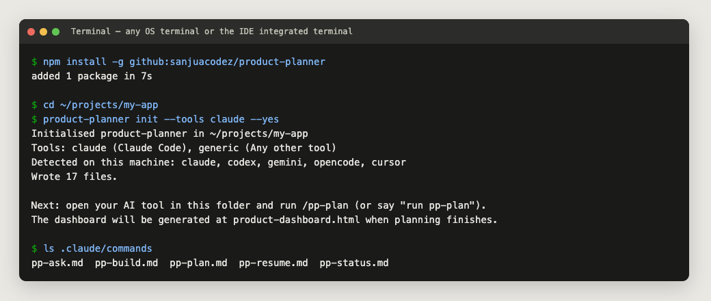

*Real output captured from a scratch project, shown in a terminal-style frame.*

## Install and run it inside Claude Code or your IDE

You do not need to leave your editor. Use whichever entry point you already work in. The **terminal** column means any terminal, including the IDE's integrated terminal (VS Code, Cursor and Windsurf: `` Ctrl+` ``; JetBrains: the *Terminal* tool window). The **chat** column means the AI tool's prompt or chat panel.

| Where you work | Install from the terminal | Install from the chat window | Then start planning |
|---|---|---|---|
| **Claude Code in a terminal** (`claude`) | Run the install and `init` commands above, then start `claude` in the project folder | Prefix shell commands with `!` to run them directly from the Claude prompt:<br>`! npm install -g github:sanjuacodez/product-planner`<br>`! product-planner init --tools claude` | `/pp-plan <your idea>` |
| **Claude Code in VS Code, Cursor or Windsurf** (Claude Code extension) | Integrated terminal: install + `init --tools claude` | In the Claude panel, ask: *“Install product-planner with `npm install -g github:sanjuacodez/product-planner`, then run `product-planner init --tools claude` in this project.”* Approve the shell commands when asked | `/pp-plan` in the Claude panel |
| **Claude Code in JetBrains IDEs** (Claude Code plugin) | Terminal tool window: install + `init --tools claude` | Same prompt as above in the Claude session | `/pp-plan` |
| **Claude desktop app** (Claude Code on a local folder) | Any terminal: install + `init --tools claude` in that folder | Ask Claude to run the same two commands | `/pp-plan`, or “run pp-plan” |
| **OpenAI Codex** (CLI or IDE extension) | `init --tools codex` | Ask Codex to run the install and `init --tools codex` commands | Invoke the `pp-plan` skill, or “run pp-plan” |
| **Gemini CLI** | `init --tools gemini` | `!` runs shell commands in Gemini CLI too, or ask it to run them | `/pp:plan` |
| **Cursor** (Agent chat) | `init --tools cursor` | Ask the agent to run the commands | `/pp-plan`, or “run pp-plan” |
| **Windsurf** (Cascade) | `init --tools windsurf` | Ask Cascade to run the commands | `/pp-plan`, or “run pp-plan” |
| **OpenCode** | `init --tools opencode` | Ask the agent to run the commands | `/pp-plan` |
| **VS Code with Copilot agent mode, Cline, Roo Code, Kilo Code; Zed, Aider, Monocode, T3 Code** | `init --tools generic` | Ask the agent to run the commands | “Read AGENTS.md and run pp-plan” |

After `init`, **reload the window or start a new chat session** if the new `/pp-*` commands do not appear yet. Agent tools ask for permission before running shell commands; approve `npm install` and `product-planner` when prompted. In Claude Code you can pre-approve the CLI with the permission rule `Bash(product-planner:*)`.

Here Claude Code runs the installed `/pp-status` command in the freshly initialized project:

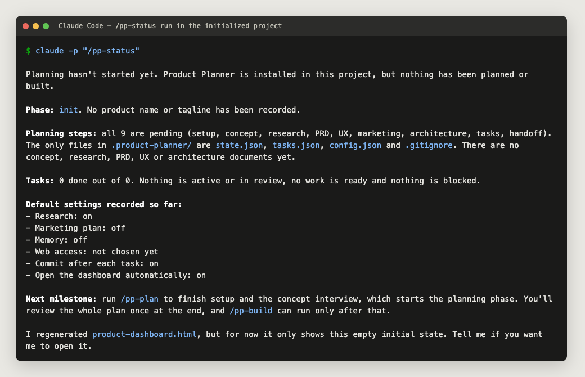

*Real Claude Code response captured with `claude -p "/pp-status"` in the project above; the interactive chat shows the same answer.*

## First project walkthrough

1. Initialize your product repository with the adapter for your coding tool.
2. Open that repository in the tool and run `pp-plan` with your idea.
3. Answer two or three short rounds of multiple-choice questions (or reply “use your recommendations”), accept or defer the proposed features, and confirm the one-page concept brief.
4. Review the complete product plan and approve it when ready.
5. Let the agent build the dependency-ordered tasks and verify them with QA. Open `product-dashboard.html` to follow progress.
6. If a session ends, run `pp-resume` in a new session to continue from the saved files.

Example starting prompt:

> Run pp-plan for a booking app for independent tutors. Tutors should manage availability, students should book sessions, and both should see upcoming appointments. Research competing products, suggest a simple UI and use free/open-source tools where practical.

## How planning asks you questions

You give a one-line idea; the agent does the drafting and asks you to choose. It follows the [interview guide](kit/guides/interview.md):

1. **Draft first, then ask.** It writes its best guess at the product from your idea, your repository and any material you supplied, and asks only where the answer would change scope, user experience, architecture, cost or acceptance. Everything else becomes a listed assumption you can correct.
2. **Short multiple-choice rounds until the plan is ready.** At most 5 questions per round, and rounds continue until the readiness gate passes: every feature decided, every request statement mapped, the quality profile chosen. A precise request may need none; "use your recommendations" ends the questions at any time and turns what is open into listed assumptions. Every question has 2–4 options with one marked *recommended* and a reason. Reply `1a 2b 3 recommended`, “use your recommendations”, or in your own words. Tools with a built-in question picker show the same choices as buttons.
3. **Pick the size of the plan.** Round 1 confirms the track:

   | Track | For | Interview and documents |
   |---|---|---|
   | `direct` | A small, precisely specified request that authorizes building (≈5 tasks or fewer, no platform or regulatory profile) | Usually no questions; request.md, features and tasks only (`pp-direct`); tests, verification and the audit still apply |
   | `quick` | Small apps, prototypes, one feature (≈15 tasks or fewer) | Usually 1–2 rounds; no research unless asked; one `plan.md` holds requirements, UX, architecture, risks and roadmap |
   | `standard` | A new product with several journeys | Usually 3 rounds; research offered; separate UX and architecture documents |
   | `existing` | Changes to an existing codebase | Code inspected and baseline.md written first; questions cover only the change |

4. **Features you accept, not prose you re-read.** Round 2 proposes a feature list (`features.json`) with priority (must / should / could / won't), release (MVP / Next / Later) and where each idea came from. Accept, defer or reject them in one reply. The agent then asks only about gaps in the accepted MVP features: who uses it, the main flow, data, roles, edge cases, integrations and what “done” looks like.
5. **A one-page concept brief.** When `pp feature check` passes (every feature decided; MVP features have acceptance criteria and no open questions), the agent shows a one-page brief to confirm: problem, user, MVP features, non-goals, success metric and key assumptions. PRD, UX, architecture and tasks are all derived from those features.
6. **Platform, markets and personal data.** The interview always asks where the product ships, where its users are, what personal data it handles and how payments work. The answers select a [quality profile](kit/guides/quality-profiles.md), which is verified against official sources during research.
7. **Research becomes a recommendation you confirm.** When a decision depends on outside knowledge, the researcher writes 2–3 options with trade-offs and sources and one recommendation, and you confirm the main user flow before the architecture is written.
8. **Nothing gets lost.** Every request statement maps to a feature or a recorded decision (`pp request list`), every task lists the feature IDs it delivers, and `pp check` fails if an accepted MVP feature has no task. Approving the plan (`pp plan approve`) records a lock snapshot; later changes go through `pp-replan`. The Roadmap tab shows each feature with its decision and task progress.

A real first round, produced by Claude Code from the one-line idea (no answers given yet):

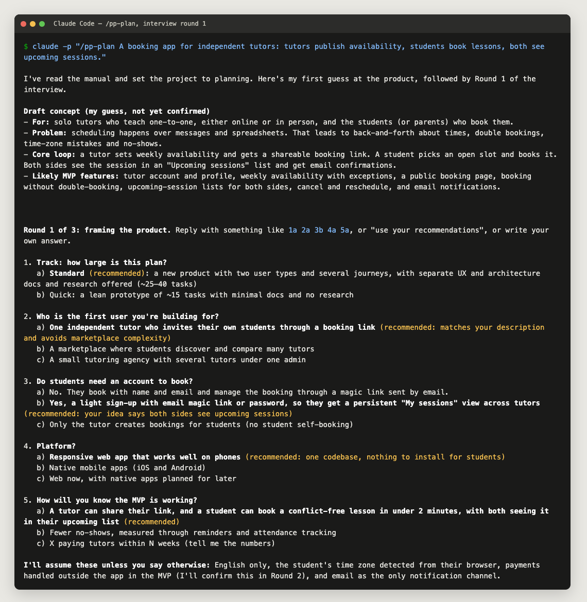

After answering “use your recommendations”, round 2 proposed 15 features and saved them. They appear on the dashboard straight away:

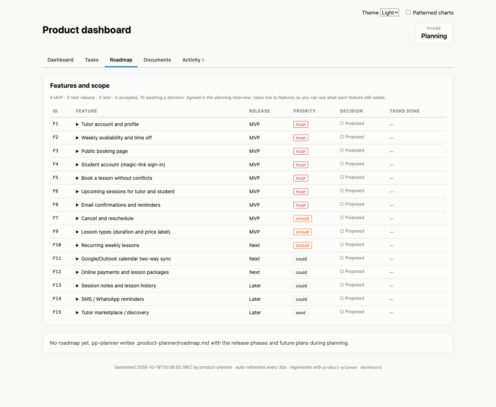

*Both screenshots come from a real run of `/pp-plan` (Claude Code, Opus 5.5) in a scratch project. Round 1 cost about $0.30 and round 2 about $0.56 at API prices, mostly cached reads of the instructions and files.*

```sh
pp feature list                    # the agreed scope, with task progress per feature
pp feature show F5                 # story, flow, acceptance, open questions, assumptions
pp feature set F12 release Later   # change a decision yourself
pp feature check                   # is the scope ready for requirements and tasks?
```

## Model selection and concurrent tasks

The kit recommends a model for every task instead of asking you to pick one per role.
`pp models available …` records what your tools, keys and plans give you (Claude, GPT, Gemini,
DeepSeek and others; inferred from the installed tools when you don't say). `pp models recommend`
then explains each choice: the minimum tier the task needs (architecture, high risk, security or
privacy checks and tasks QA returned need the strongest models; mechanical checks and small edits
can use fast ones), the cheapest available model that meets it at your project's real token mix,
review on a different provider from the implementation, and equally suitable tasks spread across
providers. Models that keep failing a kind of task in your project are skipped (`pp models stats`).
The recommendations appear in the final plan review and are applied when you approve; each tool's
agent files get the models that tool can run (Claude Code, Codex, OpenCode, Cursor, Antigravity),
and tools that choose models only in their UI get the recommendation in the brief.


The host runs models and creates subagents. Product Planner supplies the task graph,
briefs and delegation instructions. A task's `model` takes precedence over
`state.models.<agent>` and `state.models.default` as the requested model. These settings
are preferences; they do not switch the running session. The coordinator uses available
host controls, records a fallback when selection is unsupported, and records the actual
worker model on task transitions and the dashboard.

`pp task ready --json` lists every dependency-ready task; `pp task batch --json` proposes
the subset that can run together: tasks whose declared `writes` and `sources` paths do not
overlap each other or active work, up to the concurrency cap. Tasks without declared
`writes` always run alone. The build workflow asks the
host to delegate eligible independent tasks concurrently, with exclusive output paths,
settled shared contracts and at most two active build tasks by default. Set
`pp state set options.maxConcurrentTasks 1` for sequential execution, or another positive
integer for a different cap within host limits. Only the coordinator writes shared
planner state; it reviews combined changes and verifies integration before releasing
dependent tasks. When delegation is unavailable, execution stays sequential.

For example, a UI component and a separate export module can run together once their
API contracts are fixed. A database migration and code that depends on that migration
must follow dependency order. Parallel work can shorten elapsed time but can consume
more tokens; savings have not yet been measured for this workflow. See the
[execution guide](kit/guides/execution.md) for ownership and model-selection rules.

## Quality and token controls

These run as code in the CLI, so they cost no model tokens. The workflows call them at the right moments.

| Control | What it does | Why it matters |
|---|---|---|
| `request.md` | The agent saves your original request word for word, plus any later changes, dated | Paraphrasing loses requirements; the final audit checks the build against your exact words |
| Exact acceptance criteria | Every rule, number, name and error code in your request is copied into a feature's acceptance criteria and gets its own FR ID | Rules you stated become things that get tested |
| `pp check` | Checks task graph errors, unready features, MVP features without tasks, unmapped request statements and quality gates without an architecture decision or task, and warns on FR IDs no task references, unverified profiles, changes since approval, vague criteria (“fast”, “user-friendly”, “etc.”) and unfilled template sections | Catches plan gaps before any code is written, without spending tokens |
| Request coverage | `pp request list` numbers each statement of request.md (R1, R2, …); each must map to a feature's `requests` or to `notFeatures` with a reason before `pp plan approve` succeeds | A requirement can't silently drop out between your message and the plan |
| Quality profiles | Folders installed as skills when selected, so they cost tokens only where they apply. Missing platforms or laws get a researched profile (`pp profile new`) saved to your library for reuse. `pp profile detect/set/verify/run`: platform and regulatory gates (for example PHPCS + PHPStan for WordPress, privacy webhooks for Shopify, export and deletion for GDPR/DPDP). Each needs an architecture decision and a task; automated gates run with each task's verification; legal items are listed for legal review, never passed by a test | Platform standards and privacy controls are designed in, built and checked, instead of remembered at the end |
| Tests first | The developer writes at least one test per acceptance criterion, named after it, before implementing. QA records evidence for each criterion | Each criterion gets a test, so “done” is checked rather than claimed |
| Definition of done | `pp task complete T# --file report.json` records evidence for every acceptance criterion, the full test suite result, each gate the task lists, and the checks its `risk` requires (an independent reviewer from medium; integration and a security/data review for high or a task QA returned three times), then marks it done in one step. With `options.requireVerification` (default for new projects) a task can't be done without it, or when the verified files changed afterwards | “Done” needs recorded evidence, and editing code after QA forces a recheck |
| Increment review | When the last task of an epic is done, the agent runs the epic's integration checks and records them with `pp epic review E#`; with more than one epic the audit requires every review | Each increment is checked as a working slice, not just as separate tasks |
| Acceptance audit | `pp audit template` lists every request statement, every accepted MVP feature criterion and every non-legal quality gate; QA fills in evidence and `pp audit check` records it and writes `acceptance.md`, with legal items listed for review. `state phase done` refuses without a current passing audit; any later change to sources, tasks, the request or the concept makes it stale | Compares the finished code with what you asked for |
| Evidence freshness | `pp task capture T#` fingerprints the planning documents and the task's declared paths by content; the brief and `pp task freshness T#` list what changed since. Memory search skips indexed files changed since the last `memory index` | Agents are told when what they read earlier is out of date |
| Quick plan | On the quick track one `plan.md` holds requirements, UX, architecture, risks and roadmap; briefs, `pp check` and the dashboard read its sections | Less duplicated planning text on small jobs, with the same request capture, traceability and audit |
| `pp task context T#` | A brief for one task: product concept, acceptance, linked features, complete matching PRD sections, shared constraints, architecture, dependency evidence and decisions | Agents read what the task needs instead of whole documents |
| Loop warning | When QA sends the same task back 3 times, the CLI warns and logs it, and the agent must change approach or block the task with a reason | Stops the agent spending tokens repeating a failing approach |
| `risk: high` | The planner marks tasks that touch data deletion, auth, payments or permissions. They are listed at plan approval and flagged on the dashboard | You approve risky work knowingly, before the build runs unattended |
| `pp usage` | A Claude Code hook (`.claude/settings.json`, merged with your settings) reads the session transcripts and records tokens per task, phase and model, and the dashboard rebuilds on each hook event. Cost is estimated from an editable, dated price table (`pricing.models` in config.json) at API list prices | Shows what each task, role and model actually cost |

## Automatic mode and replanning

After `init`, you don't have to type commands. **Automatic mode** is on by default: the instruction file your tool loads every session (CLAUDE.md, AGENTS.md, GEMINI.md, or Cursor/Windsurf rules) tells the agent to pick the workflow from what you say:

| You say something like… | The agent runs |
|---|---|
| “I want to build a habit tracker for students” | `pp-plan`: the planning interview starts |
| “Also add a weekly email summary”, “drop payments”, “switch to mobile”, “replan” (after the plan was approved) | `pp-replan`: the change is analysed, then applied after your approval |
| “continue”, “keep going”, or a new session on a planned project | `pp-resume`: continues planning or the build from saved state |
| “how far along are we?”, “open the dashboard” | `pp-status` |
| “why did we pick SQLite?” | `pp-ask` |
| “fix this typo”, “write a quick script” | Nothing: small work outside the plan is done directly, with no planning overhead |

The agent announces the workflow in one line (“Starting pp-plan; say stop to skip”). The slash commands still work. Turn automatic mode off or back on per project:

```sh
pp auto off      # only /pp-* commands or "run pp-plan" start workflows
pp auto on
pp auto status
```

### Replanning an approved plan

You don't need to plan again from scratch. `pp-replan`:
1. Lets the task in progress finish, or parks it.
2. Shows the impact: features added, changed or dropped; tasks affected; documents to edit; new risks and costs.
3. Asks at most 5 questions, only about the change.
4. **Writes nothing until you approve the change summary.**

Then it applies the change: it edits only the affected document sections, revises tasks that haven't started (`pp task update`), removes obsolete ones (`pp task remove`), and adds follow-up tasks for completed work instead of rewriting it. Finally it validates, logs the replan in decisions.md and continues the build.

```sh
pp task update T5 --json '{"acceptance":["…","Can reschedule"]}' --note "replan: reschedule"
pp task remove T7 --reason "replan: payments deferred"
```

*Tested with Claude Code (Opus 5.5) in scratch projects:*
- *A plain idea, with no `/pp-plan`, started the interview: about $0.27.*
- *“Write a tiny hello.js” was done directly without a workflow: about $0.12.*
- *“Also add a weekly email summary” on an approved plan produced the impact analysis and 5 questions: about $0.27.*

## Start with your AI coding tool

Open the initialized product repository and invoke `pp-plan` with your idea (see the table above for each tool's syntax). The planning workflow gathers concept, audience, business goals, constraints, MVP boundaries, design preferences, research inputs and access, browser access, optional marketing, memory, which AI model should run each agent, git choices and dashboard preferences. It generates the plan and dashboard for one final review. After approval it opens the dashboard by default and continues the build. You can ask it to stop after planning or disable auto-open.

| Workflow | Purpose |
|---|---|
| `pp-plan` | Interview, research, requirements, UX, architecture and task plan |
| `pp-build` | Implement approved tasks with QA until done or all remaining work is blocked |
| `pp-resume` | Recover context and continue after an interrupted session |
| `pp-status` | Inspect progress; open the dashboard when requested |
| `pp-ask` | Answer questions or add requested dashboard information |
| `pp-replan` | Change an approved plan: impact, a few questions, one approval, synced tasks |

## Supported IDEs, coding tools and models

The package supplies workflow instructions; your chosen coding tool supplies the model and execution environment. It does not bundle a model or require a specific model vendor.

| IDE / tool | Support path today | How to start |
|---|---|---|
| Claude Code CLI / IDE integration | Dedicated agent and slash-command files | `/pp-plan` |
| OpenAI Codex | Dedicated workflow skills and AGENTS.md | Invoke `pp-plan` or say “run pp-plan” |
| Gemini CLI | Dedicated TOML custom commands and GEMINI.md | `/pp:plan` |
| OpenCode | Dedicated agents and commands | `/pp-plan` or plain-language workflow request |
| Cursor | Dedicated rules and commands | `/pp-plan` or plain-language workflow request |
| Windsurf | Dedicated rules and workflows | `/pp-plan` or plain-language workflow request |
| Monocode, T3 Code | Universal file-based instructions; no dedicated adapter | Explicitly read AGENTS.md and request pp-plan |
| VS Code with Cline, Roo Code, Kilo Code, or other coding extensions | Universal file-based instructions; loading depends on the extension | Explicitly read AGENTS.md and the installed workflow |
| Zed, Aider and other shell-capable coding tools | Universal file-based instructions; loading depends on the tool | Explicitly read the installed manual/workflow |

Dedicated integrations are tested for generated-file correctness. The Claude Code commands were also run end to end (`/pp-status`, screenshot above); other editors and versions are not yet verified end to end. Universal support requires local file access, editing and shell execution; it does not promise native slash commands or subagents. Use native delegation only when the host exposes it. Model effectiveness depends on its ability to follow instructions, use tools and verify changes.

## Tool adapter files and delegation

| Tool | Installed integration |
|---|---|
| Claude Code | `.claude/agents/pp-*.md`, `.claude/commands/pp-*.md`, CLAUDE.md block, usage hooks in `.claude/settings.json` |
| Codex | `.agents/skills/pp-*/SKILL.md`, AGENTS.md block |
| Gemini CLI | `.gemini/commands/pp/*.toml`, GEMINI.md block |
| OpenCode | `.opencode/agents/pp-*.md`, `.opencode/commands/pp-*.md` |
| Cursor | `.cursor/rules/product-planner.mdc`, `.cursor/commands/pp-*.md` |
| Windsurf | `.windsurf/rules/product-planner.md`, `.windsurf/workflows/pp-*.md` |
| Generic | AGENTS.md and the complete `.product-planner/kit/` |
| Browser (only after `pp browser setup`) | Playwright MCP entry in `.mcp.json`, `.cursor/mcp.json`, `.gemini/settings.json`, `.vscode/mcp.json` or `opencode.json` |

Ten personas cover orchestration, analysis, research, product management, UX, architecture, task planning, development, QA and optional marketing. When the host exposes delegation, the coordinator assigns specialists concrete input/output files and acceptance criteria. Otherwise it adopts those same personas sequentially. A single coordinator owns state writes; no agent framework, server or paid orchestration service is required. Compatibility depends on the host reading the installed instructions; native command availability varies by editor version.

## Agents and AI models

The CLI does not run a model: your coding tool does. To make it visible which model did what, agents pass `--agent` and `--model` on every task transition:

```sh
pp task start T3 --agent developer --model claude-opus-5-5
pp task review T3 --agent developer --model claude-opus-5-5
pp task done T3 --agent qa --model claude-sonnet-5-5 --note "Acceptance verified"
```

Each task keeps a `workedBy` list of agent/model pairs. The dashboard shows them in every task view, in the *Tasks by agent and AI model* chart and in the *Agents and AI models* table. During planning you can choose models per agent, for example a stronger model for architecture and a faster one for QA:

```sh
pp state set models.default claude-opus-5-5
pp state set models.qa claude-sonnet-5-5
```

Planned models show as *(planned)* with a dashed outline until a task records the model that actually ran. Whether a persona can run on a different model depends on the host. Claude Code subagents and OpenCode agents support per-agent models; elsewhere, the session's model runs every persona, and that is what gets recorded.

Adapter references: [OpenCode agents](https://opencode.ai/docs/agents/), [OpenCode commands](https://opencode.ai/docs/commands/), [Gemini custom commands](https://geminicli.com/docs/cli/custom-commands/).

## Planning an existing product

Initialize Product Planner inside the existing product repository, then ask:

> Run pp-plan for this existing product. First inspect its current features, architecture, data model and tests. Compare what exists with our goal of adding team workspaces, then propose an incremental roadmap. Cite the code evidence, reuse existing modules and preserve completed work.

The workflow now instructs agents to produce `.product-planner/baseline.md` before revising the PRD, architecture or roadmap. That report maps capabilities to source files, records verification and unknowns, and explains the gap to the desired outcome. Tasks should name affected components, dependencies and acceptance checks. Verified lessons go in lessons.md and can be retrieved through enabled document memory.

**Available now:** direct-inspection discovery guidance, baseline/lessons templates, existing document memory and manually maintained custom dashboard sections. This is agent-led execution, not an automatic code scan performed by init.

**Planned:** one optional SocratiCode integration for semantic code search and graph analysis, automatic source freshness checks, and better task-specific memory retrieval. GraphCode is an alternative under evaluation. Optional LanceDB remains for project documents/lessons; the design avoids duplicating the provider's entire code index. Nothing installs all these tools by default.

Read the [existing-product guide](kit/guides/existing-products.md) and [implementation stages and acceptance criteria](kit/guides/code-intelligence-plan.md).

## Browser setup

Product Planner never changes your default browser, and `init` installs nothing. Agents need a browser for research and UI QA, which is decided once, during planning:

1. **Use the AI tool's own browser if it has one.** Many tools ship one: a built-in browser or preview, a browser extension integration, or an already-configured browser MCP server. The agent checks its own tool list (the shell cannot see host tools) and records it with `pp browser use host --detail "…"`.
2. **If the tool has no browser, the agent asks you** whether to install a free, open-source option: **Playwright MCP + Chromium** (Apache-2.0, maintained by Microsoft; about 150 MB in Playwright's shared cache).
3. **If you approve, it installs and connects it:**

   ```sh
   pp browser setup                       # tools chosen at init
   pp browser setup --tools claude,vscode # or pick tools; add --headless or --engine firefox|webkit
   ```

   This pins one `@playwright/mcp` version, downloads the matching browser build, and registers the server in project-scoped config: `.mcp.json` (Claude Code), `.cursor/mcp.json`, `.gemini/settings.json`, `.vscode/mcp.json` (VS Code agent mode) and `opencode.json`. Codex and Windsurf keep MCP servers in user-level config, so the command prints the exact `codex mcp add …` command or JSON snippet to apply. Existing entries are kept unless you pass `--force`. **Reload the AI tool session afterwards** so it picks up the server, and approve it if asked.
4. **If you decline,** `pp browser use none` is recorded. Research uses `pp research search|fetch` (HTML/text only) and your supplied sources; QA records what could not be verified.

```sh
pp browser status    # recorded choice, browser MCP servers, cached browsers, installed browsers
pp browser options   # the options above
pp browser remove    # remove the Playwright entry from project configs
```

The dashboard is a local HTML file and needs none of this. Product test suites (for example Playwright Test in your product repo) are a separate architecture decision. See the [browser policy](kit/guides/browser-policy.md).

## CLI examples

```sh
pp status
pp task list
pp task next
pp task ready --json           # dependency-ready candidates for ownership review
pp task batch --json           # ready tasks with disjoint writes/sources, up to the concurrency cap
pp task add --file .product-planner/plan.json
pp task add --json '{"title":"Document local setup","acceptance":["README setup works"]}'
pp task start T1 --agent developer --model claude-opus-5-5
pp task review T1 --agent developer --model claude-opus-5-5 --note "Implementation checks pass"
pp task verify T1 --template --out t1-report.json   # fill in evidence, then:
pp task verify T1 --file t1-report.json            # or task complete T1 --file … to finish in one step
pp task done T1 --agent qa --model claude-sonnet-5-5 --note "Acceptance verified"
pp task block T2 --reason "Provider credentials missing"
pp task unblock T2
pp task validate
pp check                      # whole-plan analysis without a model: coverage, vague criteria, gaps
pp task context T5            # compact brief an agent reads instead of whole documents
pp task capture T5            # fingerprint the sources the brief relies on (task freshness T5 shows changes)
pp audit template --out audit.json   # fill in evidence, then: pp audit check --file audit.json
pp usage                      # tokens and estimated cost per task, phase and model (Claude Code hook)
pp request list               # request statements R1… and what each maps to
pp plan import --file .product-planner/plan.json   # features, epics and tasks in one validated step
pp plan approve --reason "approved in chat"        # lock the plan and start the build
pp profile detect             # suggested platform/regulatory profiles from repository signals
pp profile set wordpress-plugin gdpr --because "WordPress.org plugin; EU users"
pp profile run                # run the automated quality gates
pp task complete T1 --file .product-planner/verification/T1.report.json --agent qa --model claude-haiku-5-5
pp epic review E1 --evidence "npm test: 42 passed; checkout journey checked"
pp task update T5 --json '{"priority":"high"}' --note "replan"
pp task remove T7 --reason "replan: out of scope"
pp auto status
pp feature list
pp feature check
pp dashboard --open
pp dashboard --watch
pp browser status
pp doctor
pp help
```

Tasks follow `todo → in_progress → review → done`; block/unblock and reopen support recovery. Starting requires completed dependencies. `task next` chooses ready work by priority, epic order and task ID. It exits 2 when no task is ready (`ALL_DONE`, `ALL_BLOCKED` or `NONE_READY`; JSON mode prints null). `NONE_READY` calls for recovering active/review tasks or inspecting dependencies. IDs are E#/T#, priorities critical/high/medium/low and estimates S/M/L. Each task needs verifiable acceptance criteria. The template in `kit/templates/task-plan.json` shows the import format.

## Dashboard

`product-dashboard.html` is a single self-contained file that works offline. It is organised in tabs:

| Tab | What it shows |
|---|---|
| **Dashboard** | Phase and planning progress, KPI tiles, blocked tasks, the quality and compliance profile (gates, tasks, last results, legal-review items), estimated cost and tokens (total, per completed task, by phase, task and model), charts (status donut, tasks per epic, tasks by agent and AI model, burn-up) with data tables, summary tables (epic progress and cost, increment reviews; role · model with tasks and cost) and recent activity |
| **Tasks** | Status filters and search (by task, agent or model) across four views: **Table** (expand a task for acceptance criteria, dependencies and notes), **Board** (kanban by status), **By epic**, and **Delivery order** (dependency steps). Every task shows its agent and AI model |
| **Roadmap** | Features and scope from the interview (decision, release, task progress), then future plans: each `##` section of roadmap.md (MVP, Next release, Later…) as a lane, plus delivery milestones per epic |
| **Research** | Competitor comparison, market research and sources |
| **Documents** | Concept, PRD, UX, marketing, architecture, baseline, lessons, risks and decisions |
| **Activity** | Full activity log with agent and model |

Links are addressable, for example `product-dashboard.html#tasks/board` or `#roadmap`, and `?theme=dark` selects dark mode. Updates are event-driven, with no cron job or server: task/state/plan/profile commands regenerate the file, and so does each Claude Code usage hook event, so token and cost figures appear within one refresh. Roles and models appear as "Developer · Sonnet 5.5" (the model id on hover); if a task's transcripts show a different model from the one the agent reported, the task is flagged. Costs are estimates at API list prices; subscription plans are billed differently, and hosts without a usage hook show no cost rather than a guess. The browser reloads every 30 seconds by default and stays on the selected tab. Editing planning documents directly requires `pp dashboard`, or a running `pp dashboard --watch`. `pp dashboard --no-refresh` disables auto-refresh; `pp state set options.autoOpenDashboard false` stops it opening at the planning/build handoff.

Ask for extra sections in plain language, such as “show API endpoints and their implementation status”. The agent writes `.product-planner/dashboard/<slug>.json` (types: table, metrics, list, bar, Markdown text; `"tab"` picks where it appears) and regenerates. See `kit/templates/dashboard-section.json`.

Preview fictional demo data without initializing this source repository:

```sh
node examples/demo.js            # then open output/demo/product-dashboard.html
node examples/planning-demo.js   # planning-phase example: output/planning-demo/product-dashboard.html
```

## Screenshots: following the work

These screenshots show the current dashboard with **fictional Fieldnotes demo data** (`node examples/demo.js`). They show what you follow while the coding agent works in your editor.

### Dashboard: graphs and tables

Phase, KPIs, blocked work, status and epic charts, the agent/model chart, burn-up history, summary tables and recent activity with the agent and model behind each change.

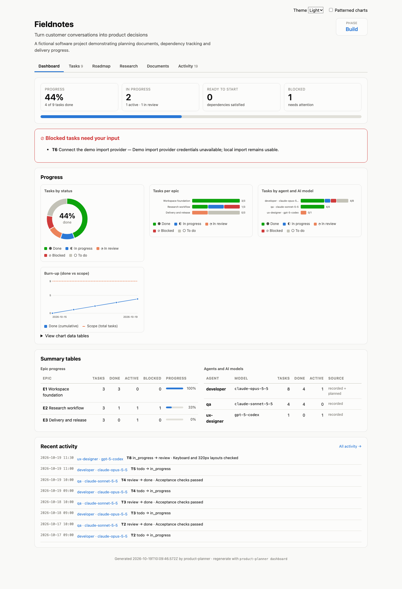

### Tasks: table view with agent and AI model

Planned assignments have a dashed outline marked *(planned)*. Recorded ones show the model that actually ran.

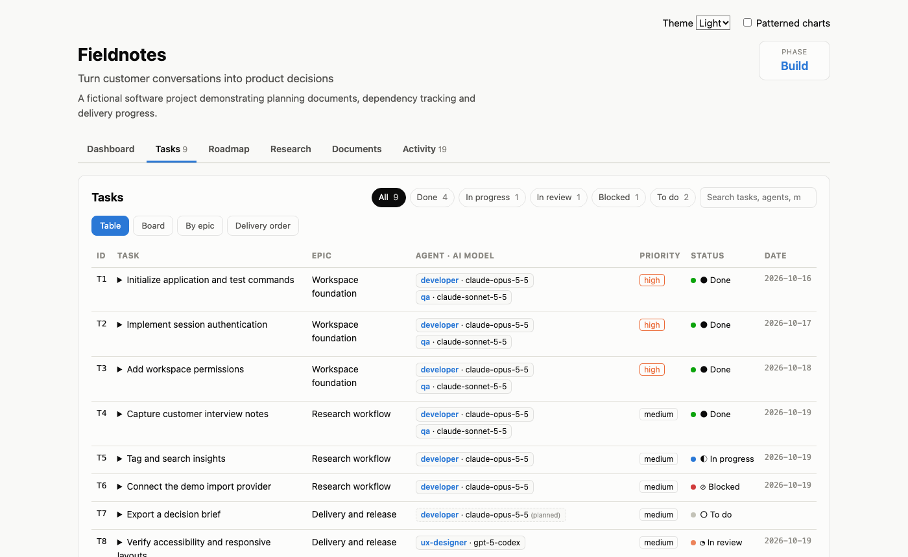

### Tasks: board view

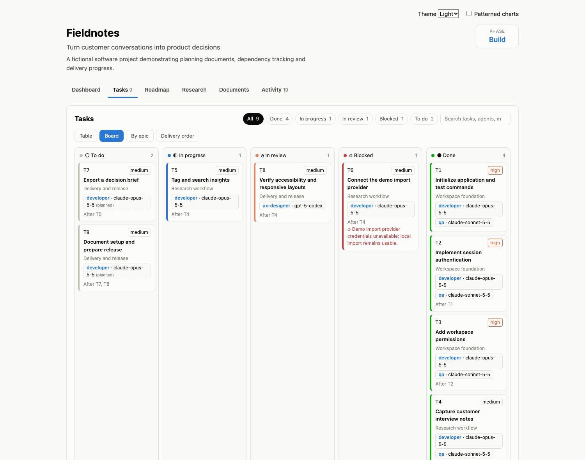

### Tasks: delivery order

Tasks grouped into dependency steps, a roadmap of the build itself.

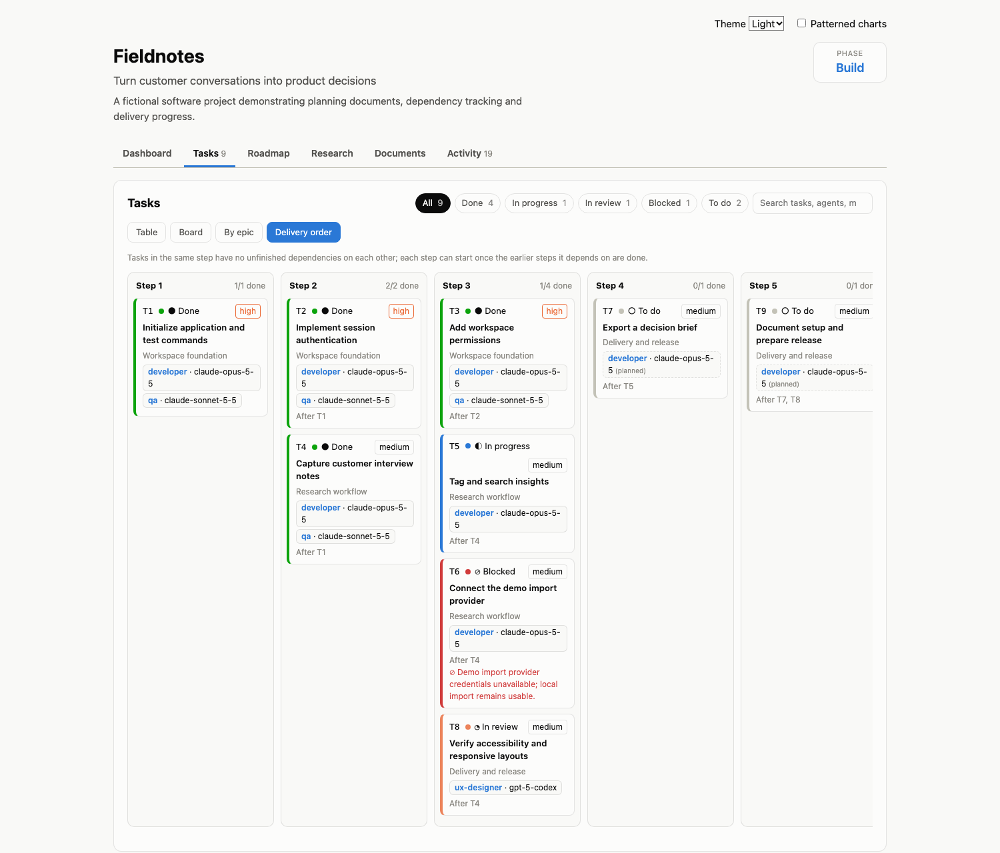

### Roadmap and future plans

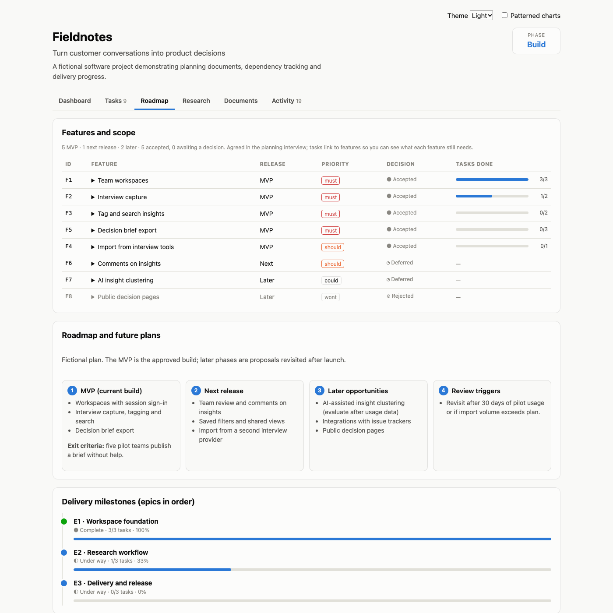

### Planning phase

Interview and document milestones while planning. For existing products, the current capability baseline appears as a custom section.

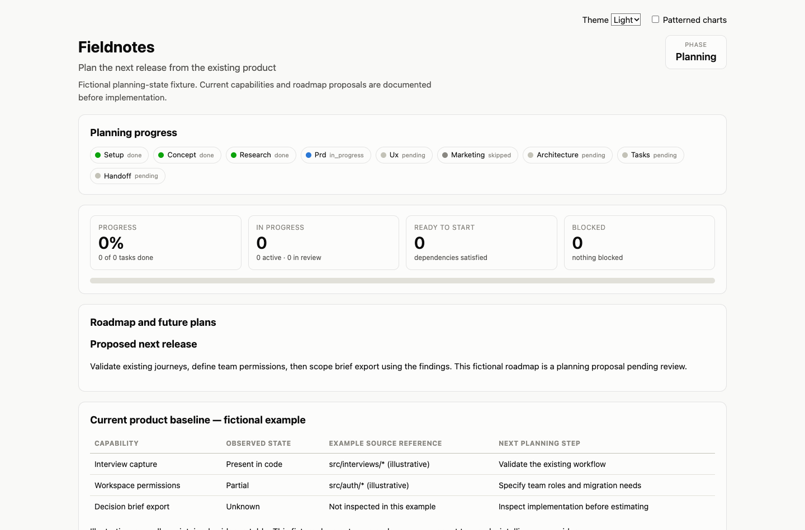

### Dark mode

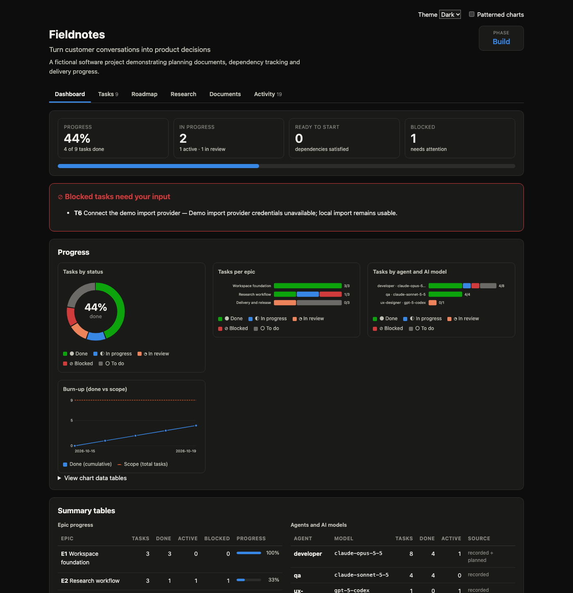

## Research and memory

Planning explicitly establishes whether research is wanted, what the user can supply, and which web tools are available. Use native search when available or the built-in keyless fallback:

```sh
pp research search "appointment booking software competitors" --max 5
pp research fetch https://example.com --max-chars 12000
pp research options
```

The fallback uses DuckDuckGo HTML and may encounter blocking, rate limits or page changes. It reports HTTP/challenge failures; the agent should use an agreed alternative or supplied sources. Dynamic/paywalled pages may need the host browser. Optional tools are discussed during planning; nothing is installed automatically. For page fetching, the official MCP reference server uses [`uvx mcp-server-fetch`](https://github.com/modelcontextprotocol/servers/tree/main/src/fetch). Save dated evidence and URLs in `.product-planner/research/sources.md`; distinguish observations from assumptions.

```sh
pp memory index
pp memory search "how does authentication work?"
pp memory status
# Optional, only when chosen: downloads npm libraries and a model on first indexing
pp memory setup
pp memory index
```

Default memory uses a local BM25 keyword index. The optional LanceDB/Transformers.js backend uses local embeddings after the initial download. Re-index when documents change. Project memory is independent of a vector database chosen for the product itself.

## Where your files are saved

Everything Product Planner creates lives **inside your product repository**: one folder, `.product-planner/`, plus the generated dashboard and the small adapter files for your tools. Nothing is stored in a hidden global location except the CLI itself and, if you opt in, shared download caches.

```
your-product/
├── .product-planner/                 ← all project data (commit this)
│   ├── state.json                    phase, planning steps, options (research, browser, memory…), planned models
│   ├── config.json                   tools installed, dashboard/research/memory settings
│   ├── request.md                    your original request(s), verbatim
│   ├── acceptance.md                 final acceptance audit (requirement → evidence → result)
│   ├── usage.jsonl                   tokens per task/phase (Claude Code hook)
│   ├── features.json                 feature register from the interview (scope, decisions, acceptance)
│   ├── tasks.json                    epics and tasks, incl. features delivered and workedBy agent/model history
│   ├── plan.json                     task plan written by pp-planner before import
│   ├── log.jsonl                     append-only activity log (feeds burn-up and Activity tab)
│   ├── concept.md  prd.md  ux.md  architecture.md  marketing.md
│   ├── roadmap.md  risks.md  decisions.md  baseline.md  lessons.md
│   ├── research/                     market.md, competitors.json, sources.md
│   ├── dashboard/*.json              custom dashboard sections you asked for
│   ├── memory/index.json             keyword memory index (rebuildable)
│   ├── memory/lancedb/               optional vector DB          ┐ git-ignored,
│   ├── memory/node_modules/, models/ optional libs + embeddings ┘ rebuildable
│   └── kit/                          installed copy of agents/workflows/templates (regenerated by init)
├── product-dashboard.html            generated dashboard (path set in config.json)
├── AGENTS.md / CLAUDE.md / GEMINI.md marked Product Planner block inside your file
├── .claude/ .agents/ .gemini/ .opencode/ .cursor/ .windsurf/   adapter files (regenerated by init)
└── .mcp.json, .cursor/mcp.json, …    only if you approved `pp browser setup`
```

Outside the project, only these exist: the global CLI from `npm install -g`, npm's `npx` cache, Playwright's shared browser cache (`~/Library/Caches/ms-playwright` on macOS, `~/.cache/ms-playwright` on Linux, `%LOCALAPPDATA%\ms-playwright` on Windows) if you approved a browser, and user-level MCP config for Codex/Windsurf if you applied it.

### Moving a project to another folder, machine or repository

Yes, you can. Everything that matters is in `.product-planner/`.

1. **Same repository, new machine:** `.product-planner/` is committed with your code, so clone the repo, install the CLI (`npm install -g github:sanjuacodez/product-planner`) and run `product-planner init --tools <your tools>` to regenerate adapter files. Planning data is kept as-is.
2. **Different folder or repository:** copy the whole `.product-planner/` folder into the new project root (optionally also `product-dashboard.html`), then run `product-planner init --tools <your tools>` there. Init keeps the copied state/tasks/docs and rewrites the kit and adapter files. If the source code also moved, ask the agent to run `pp-resume`; it compares the baseline with the new repository before continuing.
3. **Rebuild what isn't copied:** run `pp memory index` (and `pp memory setup` first if you used vector memory, because `memory/lancedb`, `node_modules` and `models` are git-ignored), `pp dashboard` to regenerate the HTML, and `pp browser setup` again if the new machine needs the Playwright browser.
4. **Check it:** `pp status`, `pp task validate` and `pp doctor`.

The phase, approvals, task history, agent/model records and activity log travel with the folder. Paths inside the docs are relative, so nothing needs editing.

## Git and removal

`.product-planner/` is intended for git; heavy local vector/model artifacts are ignored by its own `.gitignore`. The agent commits per task when agreed during planning, while preserving unrelated user changes. It never pushes without prior authorization. The CLI does not push or commit automatically.

`pp uninstall` removes the known adapter files and marked instruction blocks, while keeping project state/docs, the installed kit and dashboard. `pp browser remove` removes the Playwright MCP entry. Generated adapter files are managed by this package; do not store unrelated custom content in them.

## Updating and uninstalling

To update, reinstall the CLI (or pull your linked checkout), then refresh the generated files in each product project:

```sh
npm install -g github:sanjuacodez/product-planner   # global install
# or, in a linked checkout: git pull --ff-only

# In each product project; keep the same desired tool selection
product-planner init --tools claude,codex
```

Keep custom project instructions outside the marked Product Planner blocks and custom decisions outside the installed kit. Commit or back up your product project before updating generated files. Task and planning data are retained by init.

To remove integration files from a product project:

```sh
product-planner uninstall
```

To remove the global CLI:

```sh
npm uninstall --global product-planner
```

## Troubleshooting

| Problem | What to do |
|---|---|
| `product-planner` or `pp` is not found | Run `npm install -g github:sanjuacodez/product-planner` (or `npm link` from a checkout) and make sure npm's global bin directory (`npm prefix -g`/bin) is on PATH. IDE terminals and agent shells may need a restart to see a new PATH. |
| A slash command does not appear | Reload the window or start a new chat session after init, check that the right adapter is selected, or ask the agent to read `.product-planner/kit/workflows/pp-plan.md` directly. |
| The browser MCP server does not show up | Reload the AI tool session after `pp browser setup` and approve the project MCP server if prompted; run `pp browser status`. For Codex/Windsurf apply the printed user-level command or snippet. |
| The dashboard shows “model not recorded” | The agent moved tasks without `--model`. Plan models with `pp state set models.<agent> <id>`, or ask the agent to pass `--model` on transitions. |
| The dashboard looks stale | Run `pp dashboard`; use `pp dashboard --watch` while editing docs directly. Browser refresh reads the last generated HTML. |
| Research is blocked or empty | Use native browser tools or supplied sources and record the limitation. The keyless search service may rate-limit or change its HTML. |
| No task is ready | Run `pp status` and `pp task validate`; recover active/review tasks or resolve recorded blockers. |

Run `pp doctor` from an initialized product repository for environment checks, or set `PP_DEBUG=1` when diagnosing CLI errors.

## License and distribution

The repository is public on GitHub. `package.json` keeps `private: true` so it is never accidentally published to the npm registry; install it from GitHub as shown above. No license file has been added yet (`UNLICENSED`), so default copyright applies until one is chosen. Your AI provider's data handling is unchanged: research, model requests and optional downloads use the tools you authorize.

## Development and verification

```sh
npm test
npm run check
npm pack --dry-run
```

Tests use temporary directories and cover all adapter outputs, repeat installation, removal preservation, task dependency/cycle checks, CLI import and lifecycle, agent/model recording, feature readiness and coverage, automatic-mode routing on/off, replanning task updates/removals, dashboard tabs/views/escaping/custom data, delivery-order and roadmap parsing, browser MCP registration, research parsing, memory retrieval and stale-memory exclusion, state-path validation, quick-plan sections, ownership-aware batching, content-based evidence freshness, risk-based verification and the final audit gate, and usage attribution across models and subagents. No network is needed for the test suite. Editor command loading and actual LLM execution require a session in each host; generated-file checks do not replace that integration testing. Optional vector and browser downloads are not part of the core tests.
