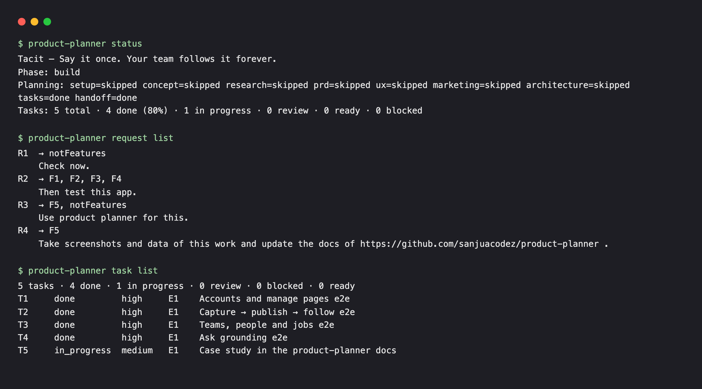
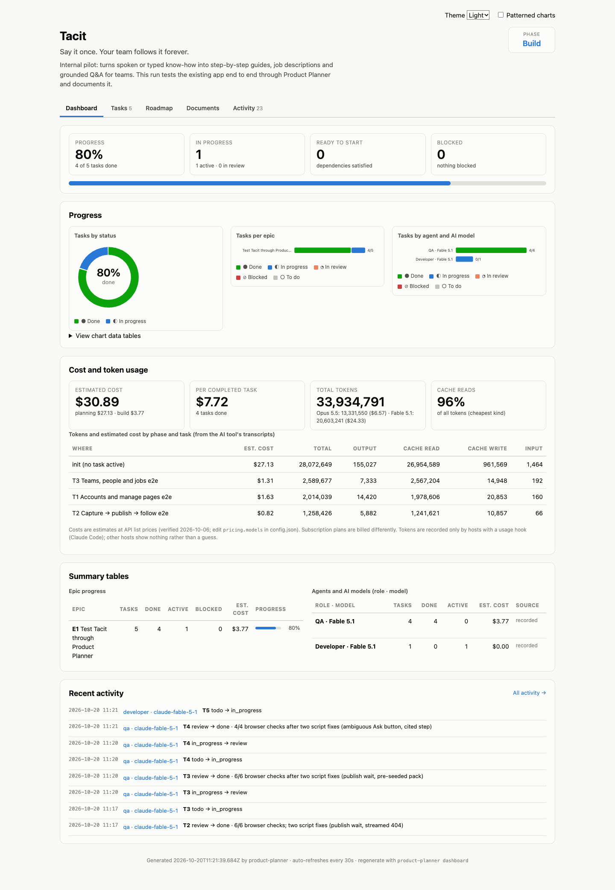
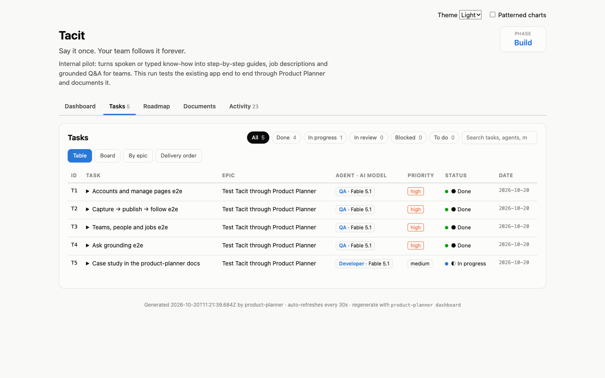
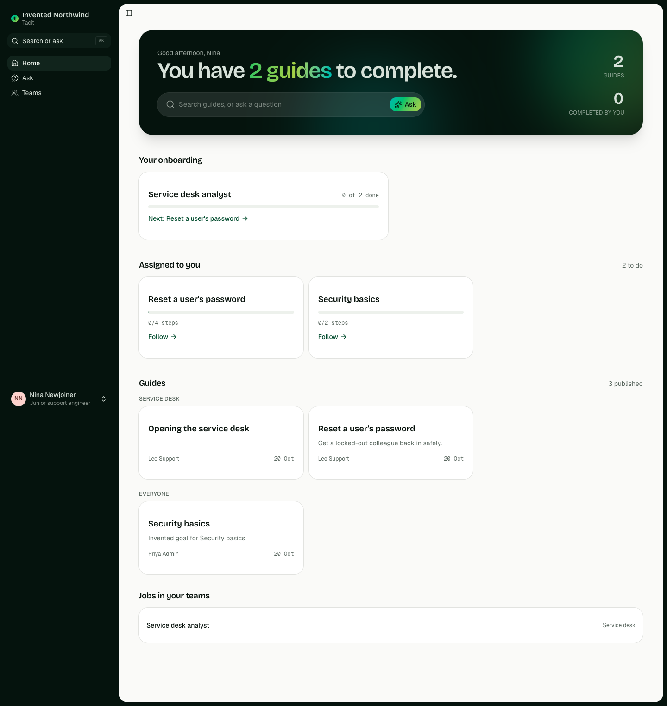
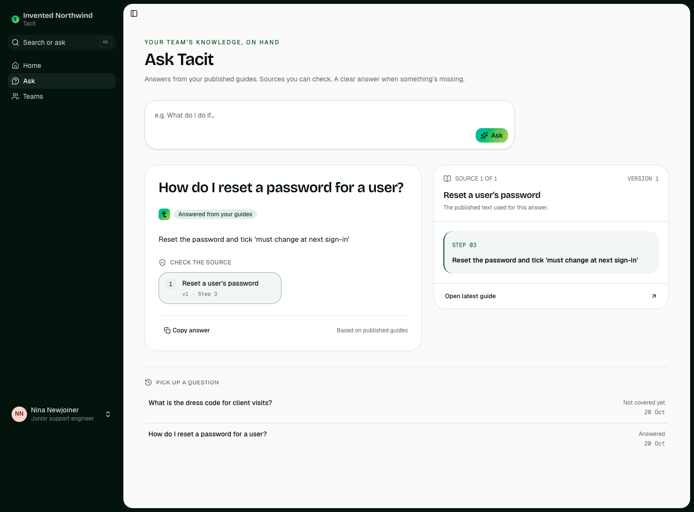

# Case study: testing an existing app through `pp-direct`

*2026-10-20 · Claude Code (Fable 5.1) · product-planner 0.1.0 · one run, not a benchmark*

This is a real session, written up from the files Product Planner left behind. The product is **Tacit**, an internal pilot app (Next.js 16, PostgreSQL, a Node worker, 18 routes, 87 unit and integration tests) that turns spoken or typed know-how into step-by-step guides, job descriptions and grounded Q&A. It had been built over several days without Product Planner. The owner then installed the kit and typed, in one message:

> Check now. Then test this app. Use product planner for this. Take screenshots and data of this work and update the docs of https://github.com/sanjuacodez/product-planner .

Everything below comes from `.product-planner/` in that repository: `request.md`, `plan.json`, `tasks.json`, `log.jsonl`, `usage.jsonl` and the verification reports. All screenshots show an **invented workspace** ("Invented Northwind", people such as *Nina Newjoiner* with `example.invalid` emails) on a separate test database, never the owner's real data.

## What the agent did

1. **Checked the app** (R1). It answered 500: the PostgreSQL container had stopped overnight. Restarting the container fixed it; nothing in the code had changed. This happened before planning and is recorded as a `notFeature`.
2. **Chose `pp-direct`.** The request was small and precise and authorized building, so no interview and no planning documents: request captured verbatim, every statement mapped, a plan of 5 features and 5 tasks, approval, build with recorded verification, audit.
3. **Wrote one browser test per area** with `playwright-core` against a second Tacit instance on port 3300 (test database, offline AI, the invented seed), each producing a `results.json` and screenshots as evidence.
4. **Documented it here** (R4), as task T5.

## The plan, in numbers

| | |
|---|---|
| Request statements | 4 (R1 done before planning; R2 → F1–F4; R3 and R4 → F5) |
| Features | 5, all `must` / MVP, 27 acceptance criteria written with exact values |
| Tasks | 5 in 1 epic, dependency-ordered (T2 after T1, T3 and T4 after T2, T5 after all) |
| Planning time | about 10 minutes from the first command to `plan approve` |
| Build time, T1–T4 | 11 min 14 s from `plan approve` (11:10:25Z) to T4 done (11:21:39Z) |
| Browser checks | 31 (15 + 6 + 6 + 4), all passing in the final run; 0 console errors |
| Script fixes during the build | 7 (selectors and waits), none of them app defects |
| App defects found | 1 fixed, 2 observations (below) |

### Tasks

| Task | What it tested | Checks | Run time | Worked by |
|---|---|---|---|---|
| T1 Accounts and manage pages | invite → join with the one-time link → sign out → wrong then right password → account page → admin-only pages → old URLs redirect → no horizontal overflow at 1440 px and 390 px | 15/15 | 12.5 s | QA · Fable 5.1 |
| T2 Capture → publish → follow | typed explanation → live outline (6 items) → "Create the guide" → draft in the editor in under 60 s (offline AI) → "Approve & publish" → v1 → a member follows every step, progress survives reload → an outsider gets "Not found." | 6/6 | 16.7 s | QA · Fable 5.1 |
| T3 Teams, people and jobs | sub-team → add a person → describe a job → draft → publish → "Add a level" (Senior) → pack of 2 guides → give a person the job → her Home shows "Your onboarding · 0 of 2 done" → team Progress tab | 6/6 | 18.5 s | QA · Fable 5.1 |
| T4 Ask grounding | a question answered from a published guide with a receipt showing the cited step verbatim and its version; an unrelated question gets "Not covered yet" with no sources and appears in the owners' open-questions list | 4/4 | 4.1 s | QA · Fable 5.1 |
| T5 This case study | files in the product-planner repository, README link, commit and push | — | — | Developer · Fable 5.1 |

## What the tests found in the app

- **Fixed:** `/team` (the old People URL) had no redirect to `/people` after a navigation rework the day before. T1's first run caught it; a 3-line redirect page was added and the task note records it.
- **Observation:** a team-only guide shows the "Not found." page to someone outside the team and sends no guide content, but the HTTP status is **200**, because the app has a `loading.tsx` and Next.js streams the shell before the page decides. The acceptance criterion said "404"; the report records the nuance instead of bending the app.
- **Observation (good):** a new job's "guides to learn" list is pre-filled from the guides the AI names in the draft. The script had assumed an empty list and had to clear it first.

## What the run found in Product Planner

Things a first-time user of the kit hits, recorded so they can be fixed or documented:

1. **Request statements are split per paragraph.** A four-sentence request on one line became a single statement R1. Putting one sentence per paragraph gave R1–R4 and a useful mapping. The interview guide could say so, or the parser could split sentences.
2. **`writes` / `sources` reject `[` and `]`.** Next.js route folders such as `src/app/(auth)/invite/[token]` cannot be listed as sources, so `task complete` failed on T1 until the sources were re-pointed at module folders. Brackets are glob characters to the kit; a way to list literal paths would help.
3. **`notFeatures` shape.** The workflow text says "each with a reason"; the importer wants `{ "requests": ["R1"], "reason": "…" }`. One failed import, then fine.
4. **`task complete` refuses failing evidence.** When T4's script had a selector bug, the report showed 3/4 and the CLI answered `missing passing evidence`. That is the right behaviour and it worked as described.
5. **Token attribution is only trustworthy per task.** The Claude Code hook reads the session transcript from the moment it was installed. Here the "init (no task active)" bucket shows **$27.13**, most of it Opus 5.5 turns from the same session *before* Product Planner was installed, plus the Docker investigation. The build-stage numbers are the meaningful ones: T1 $1.63, T2 $0.82, T3 $1.31 (T4 was still being attributed when this was written), about **$3.8 for 31 passing browser checks**, 96 % of tokens being cache reads. A session-scoped baseline at `init` would make the planning figure honest.
6. **`doctor` reports web access "unreachable (HTTP 400)"** on a machine with a working connection; the kit's own research fetch probe needs a look. It did not matter here, as no research was needed.

## Limitations

- One run, one model, one small app. No comparison with plain prompting was made for this task.
- The "AI" in the tested app was its offline rule-based stand-in, so the tests prove the flows and permissions, not the quality of real drafts.
- The browser scripts live under `.product-planner/verification/e2e/` and need Chrome and `playwright-core` from outside the app (adding Playwright to the app is a pending decision there); they are evidence of this run, not yet part of the app's CI.
- Everything was done by the host session itself; no sub-agents were delegated, so the "QA · Fable 5.1" attribution means the same session adopting the persona.

## Files

- Request, plan and state: `.product-planner/request.md`, `plan.json`, `features.json`, `tasks.json`, `log.jsonl`
- Verification: `.product-planner/verification/T1–T4.report.json`, `verification/e2e/*.mjs`, `verification/evidence/T*/results.json` and screenshots
- Dashboard: `product-dashboard.html` (regenerated by every task command)
